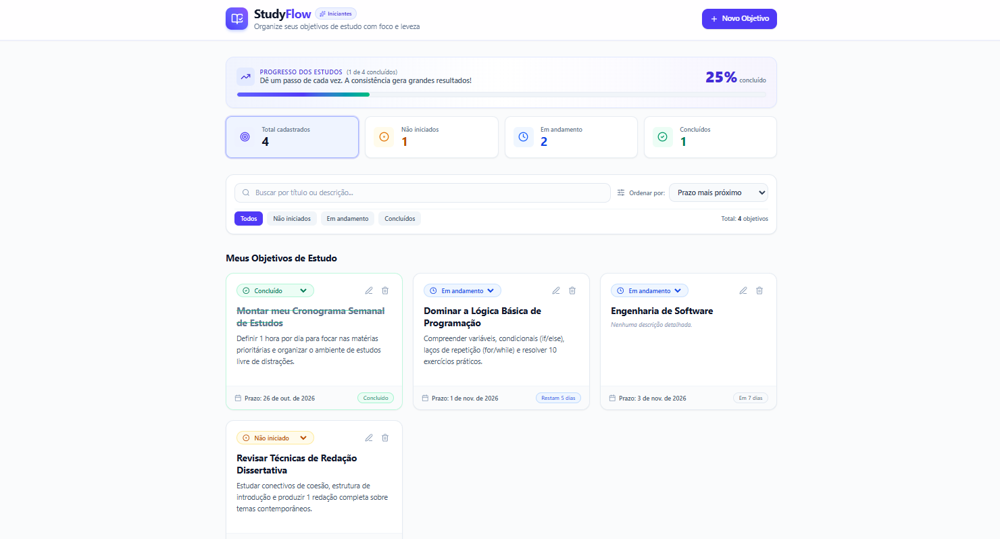

# 🎓 StudyFlow — Organização de Objetivos de Estudo

> Uma aplicação web simples, acolhedora e intuitiva desenvolvida para ajudar estudantes iniciantes a planejar, acompanhar e alcançar suas metas de aprendizagem sem complicação ou sobrecarga cognitiva.

<br />

<p align="center">
  
</p>

---

## 📌 Sumário

- [Visão Geral / Demonstração](#-visão-geral--demonstração)
- [Sobre o Projeto](#-sobre-o-projeto)
- [Problema que o Aplicativo Resolve](#-problema-que-o-aplicativo-resolve)
- [Público-Alvo](#-público-alvo)
- [Principais Funcionalidades](#-principais-funcionalidades)
- [Tecnologias Utilizadas](#-tecnologias-utilizadas)
- [Estrutura do Projeto](#-estrutura-do-projeto)
- [Como Executar o Projeto Localmente](#-como-executar-o-projeto-localmente)
- [Como Funciona a Persistência de Dados](#-como-funciona-a-persistência-de-dados)
- [Critérios de Qualidade e Boas Práticas](#-critérios-de-qualidade-e-boas-práticas)
- [Licença](#-licença)

---

## 📸 Visão Geral / Demonstração

A interface do **StudyFlow** foi desenhada para oferecer uma experiência visual limpa e amigável:


* **Monitoramento de Metas:** Barra de progresso visual que se atualiza automaticamente conforme os objetivos são concluídos.
* **Métricas em Tempo Real:** Indicadores clicáveis de metas não iniciadas, em andamento e concluídas.
* **Organização Descomplicada:** Filtros por status, busca por texto e ordenação inteligente por proximidade do prazo.

---

## 💡 Sobre o Projeto

O **StudyFlow** nasceu da necessidade de oferecer uma alternativa leve aos softwares de produtividade convencionais (como Notion, Jira ou planilhas densas), que muitas vezes intimidam quem está começando a estudar.

A aplicação foca no essencial: definir claramente **o que aprender**, **até quando concluir** e **acompanhar a evolução diária** com feedback visual imediato.

---

## 🎯 Problema que o Aplicativo Resolve

* **Sobrecarga de planejamento:** Plataformas complexas demandam muito tempo de configuração antes mesmo de o aluno começar a estudar.
* **Perda de prazos:** Sem lembretes visuais ou centralização, o estudante perde a noção de quando revisar conteúdos essenciais.
* **Falta de sensação de progresso:** Ao não ver de forma gráfica o quanto já evoluiu, o iniciante tende a desanimar precocemente.
* **Fricção de cadastro e contas:** O StudyFlow funciona imediatamente no navegador, sem necessidade de login ou senhas nesta versão.

---

## 👥 Público-Alvo

1. **Vestibulandos e Concurseiros Iniciantes:** Que precisam distribuir tópicos do edital em metas semanais.
2. **Estudantes em Transição de Carreira e Autodidatas:** Pessoas aprendendo programação, idiomas, design ou outras habilidades por conta própria.
3. **Alunos do Ensino Fundamental II e Médio:** Que buscam criar o hábito de organizar tarefas escolares com autonomia.

---

## ✨ Principais Funcionalidades

### 1. 📝 Cadastro Completo de Objetivos
- **Título da meta:** O que você deseja aprender (ex.: *"Dominar Funções em JavaScript"*).
- **Descrição detalhada (opcional):** Espaço para anotar links, capítulos do livro ou exercícios a resolver.
- **Prazo com atalhos rápidos:** Seletor de data com botões de 1 clique (*Hoje*, *Em 3 dias*, *1 semana*).
- **Status inicial configurável:** Escolha entre *Não iniciado*, *Em andamento* ou *Concluído*.

### 2. 📋 Cartões de Estudo Dinâmicos
- Apresentação em cartões limpos com destaque de tipografia e badges de status coloridos.
- **Indicador inteligente de prazo:**
  - 🚨 *Atrasado há X dias* (alerta em vermelho).
  - ⏳ *Vence hoje!* (destaque pulsante em âmbar).
  - 📅 *Vence amanhã* ou *Restam X dias*.
  - ✅ *Concluído* (verde).
- Alteração rápida de status diretamente no cartão sem precisar abrir o formulário.

### 3. 📊 Painel de Métricas e Progresso
- Contador do **Total de Objetivos Cadastrados**.
- Contadores segmentados por status (*Não iniciados*, *Em andamento*, *Concluídos*).
- **Barra de progresso percentual** com mensagens motivacionais dinâmicas.
- Filtros com um clique clicando diretamente nos cards de métricas.

### 4. 🔍 Busca e Ordenação
- Campo de pesquisa em tempo real por palavras-chave no título ou na descrição.
- Ordenação por:
  - Prazo mais próximo (padrão);
  - Prazo mais distante;
  - Mais recentes primeiro;
  - Ordem alfabética (A-Z).

### 5. ✏️ Edição e Atualização
- Edição completa de qualquer objetivo já cadastrado, mantendo o histórico de atualização.

### 6. 🗑️ Exclusão Segura com Confirmação
- Modal dedicado que exibe o título do objetivo e exige confirmação explícita do usuário, prevenindo cliques acidentais.

### 7. 💾 Persistência Automática (`localStorage`)
- Todos os dados permanecem salvos no navegador mesmo após fechar a aba ou recarregar a página (F5).
- Botão no rodapé para carregar objetivos de exemplo práticos ou limpar todos os dados.

### 8. 🎈 Mensagens de Estado Vazio (*Empty State*)
- Interface amigável e acolhedora quando não há objetivos cadastrados, incentivando o estudante a dar o primeiro passo.
- Mensagem informativa caso nenhum resultado seja encontrado na busca com botão para limpar filtros.

---

## 🛠️ Tecnologias Utilizadas

- **[React 19](https://react.dev/):** Biblioteca para criação de interfaces declarativas e reativas baseada em componentes funcionais e hooks.
- **[TypeScript](https://www.typescriptlang.org/):** Tipagem estática para maior robustez, manutenibilidade e prevenção de bugs.
- **[Tailwind CSS v4](https://tailwindcss.com/):** Estilização utilitária de alta performance para um design limpo, moderno e responsivo.
- **[Lucide React](https://lucide.dev/):** Conjunto consistente de ícones para guiar o usuário visualmente.
- **[Vite](https://vitejs.dev/):** Ferramenta de build e servidor de desenvolvimento ultrarrápido.
- **Armazenamento:** API nativa do navegador `window.localStorage` (100% client-side, sem dependência de backend).

---

## 📁 Estrutura do Projeto

```text
studyflow/
├── src/
│   ├── components/                 # Componentes desacoplados da interface
│   │   ├── Header.tsx              # Cabeçalho com logo, identificador e botão de ação
│   │   ├── StatsOverview.tsx       # Métricas, contadores e barra de progresso
│   │   ├── GoalFilterBar.tsx       # Busca textual, ordenação e abas de status
│   │   ├── GoalCard.tsx            # Cartão de exibição individual com prazos e status
│   │   ├── GoalFormModal.tsx       # Formulário modal para criação e edição
│   │   ├── DeleteConfirmModal.tsx  # Diálogo de confirmação para exclusão segura
│   │   ├── EmptyState.tsx          # Estados vazios e incentivo ao primeiro cadastro
│   │   └── FooterTips.tsx          # Rodapé com dicas pedagógicas e persistência
│   ├── services/
│   │   └── storageService.ts       # Camada de abstração e persistência no localStorage
│   ├── types/
│   │   └── goal.ts                 # Definições de tipos e interfaces em TypeScript
│   ├── utils/
│   │   └── dateUtils.ts            # Formatação de datas em pt-BR e cálculo de prazos
│   ├── App.tsx                     # Orquestrador principal de estado da aplicação
│   ├── main.tsx                    # Ponto de entrada React DOM
│   └── index.css                   # Importação do Tailwind CSS
├── index.html                      # HTML base com meta tags e OpenGraph
├── package.json                    # Dependências e scripts do projeto
├── tsconfig.json                   # Configurações do compilador TypeScript
├── vite.config.ts                  # Configuração do Vite
└── README.md                       # Documentação completa do projeto
```

---

## 🚀 Como Executar o Projeto Localmente

### Pré-requisitos
- [Node.js](https://nodejs.org/) versão 18 ou superior instalada em seu computador.
- Gerenciador de pacotes `npm` ou `yarn`.

### Passo a Passo

1. **Clone este repositório:**
   ```bash
   git clone https://github.com/SEU_USUARIO/SEU_REPOSITORIO.git
   cd studyflow
   ```

2. **Instale as dependências:**
   ```bash
   npm install
   ```

3. **Inicie o servidor de desenvolvimento:**
   ```bash
   npm run dev
   ```

4. **Abra no seu navegador:**
   - Acesse o endereço exibido no terminal (geralmente `http://localhost:3000` ou `http://localhost:5173`).

5. **Para gerar a versão de produção (Build):**
   ```bash
   npm run build
   ```

---

## 💾 Como Funciona a Persistência de Dados

O StudyFlow utiliza o `localStorage` do navegador sob a chave `'studyflow_goals_v1'`.

- Ao abrir a aplicação pela primeira vez, o serviço verifica se existem metas salvas.
- Se for a primeira visita, são carregadas 3 metas de exemplo práticas para inspirar o usuário.
- A cada criação, edição, alteração de status ou exclusão, os dados são automaticamente serializados em JSON e armazenados no cliente.
- Caso você recarregue a página (F5) ou feche o navegador, todas as informações permanecem intactas.

---

## 🌟 Critérios de Qualidade e Boas Práticas

- **Design Acolhedor:** Cores suaves, bordas arredondadas e ausência de elementos visuais agressivos.
- **Acessibilidade:** Botões com `aria-label`, foco visível para navegação por teclado e rótulos associados a cada campo de entrada.
- **Validação Amigável:** Mensagens em português claro caso algum campo obrigatório não seja preenchido.
- **Sem Dependência de Servidor:** Execução ágil, sem risco de lentidão ou custos com banco de dados nesta etapa.

---

## 📄 Licença

Este projeto está sob a licença [Apache 2.0](https://www.apache.org/licenses/LICENSE-2.0). Sinta-se livre para utilizar, estudar e adaptar para suas próprias necessidades de estudo!
